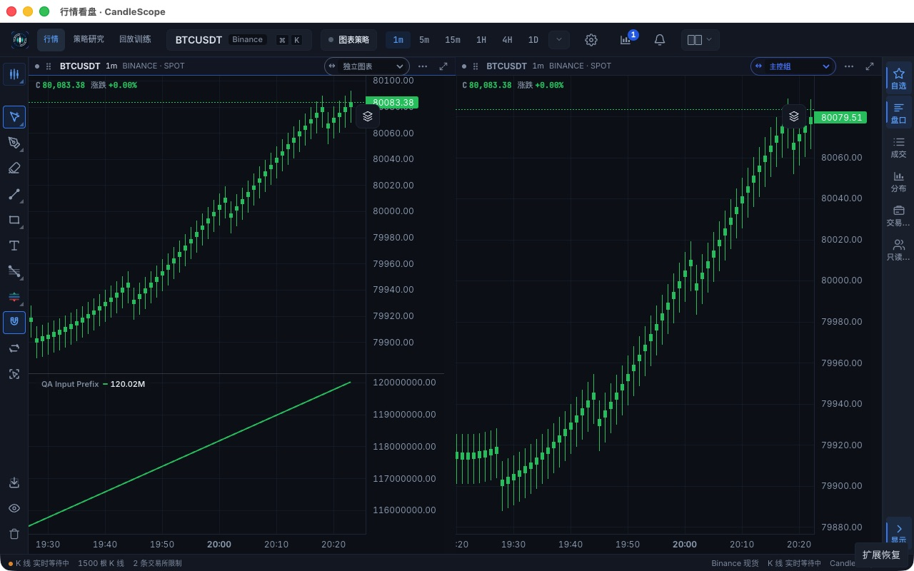

# Integration and native recovery follow-up — 2026-10-30

Implementation: `83def15695bd0cc3f650720b4add617fe72a38d7`, integrated with
main `56d07af822c665556d3dd280bf5d6a2a2107043c`. The previous acceptance report
and its measurements remain historical evidence at their named revisions.

## Correctness and native observations

Mainline integration preserves requested-period/anchor admission and Pine scene
reconciliation. Warming skips a preserved period unavailable on the target
instrument. The additional Pine drawing-only regression verifies that an old
scene cannot replace a newer one, and an amended shared input revokes an
in-flight completion.

Native testing then exposed an indicator-first recovery defect. While minimized,
a 150ms frontend-JS cumulative indicator received a 1,500-row recovery before
the candle series (still displaying 500 rows). That indicator extended the shared
time axis. Candle publication compensated using its old local array offset and
added the 997-row shift again: the left viewport became 2465.875–2523.875 and
showed no candles. The new regression reproduced exactly that range before the
fix. `ViewportController` now obtains an anchor's logical position from the
actual shared chart axis before and after a structural write, retaining the
existing fallback for adapters without coordinate conversion.

The same actual native minimize → disconnect → three unseen new bars plus a
historical amendment → reconnect → restore sequence now succeeds without another
market tick. Both stores and displayed candle series contain 1,500 correct rows;
all 1,500 JS indicator values equal their own input prefix. Both viewports overlap
the retained data and the left viewport no longer jumps beyond the data.
The hidden candle series retain 500 rows and the scheduler has zero runnable
frames. Indicators can still accept and publish results while hidden; this is
**not** a claim that every hidden React/indicator operation is suspended.

[Machine-readable integration receipt](post-integration.json) includes the
native lifecycle, numeric comparisons and post-integration focus/prewarm promotion:
one delayed 5m history request, one completion and one promotion, with no duplicate
foreground request. Native independent navigation moves A's viewport while B's
rows and viewport remain unchanged. That repeat used a 500-row window; the earlier
deep pagination/10,000-row bound case remains separately revision-labelled.

## Final fixed-input comparison

Protocol: same isolated native host,
no active indicators, 500 rows per chart, left chart focused, fixed 12,200-row
corpus, 200 forming updates at absolute 50ms deadlines, one warmup and five
measured runs per build/layout. Both builds are rerun after the environment
restart. Earlier 1,501-row and interrupted 500-row experiments are excluded.

Pooled P95 in milliseconds; main `56d07af8` → implementation `83def156`:

| Layout / consumer | Input to Store commit | Input to chart-series publication |
| --- | ---: | ---: |
| Single / focused | 0.3 → 0.3 | 15.3 → 14.2 |
| Dual / focused | 0.2 → 0.3 | 8.3 → 16.0 |
| Dual / visible-secondary | 0.2 → 0.6 | 15.7 → 16.5 |

Each consumer observes all 1,000 measured commits and publications. Every run
uses one physical K-line stream and zero HTTP reads during measurement. The
secondary admission overhead is about 0.4ms at P95; dual display P95 increases by
7.7ms / 0.8ms. A faster single-chart sample does not establish a general speedup.
The 50ms input cadence and RAF phase affect display distributions. No GPU/FPS,
live-exchange latency or retained-heap improvement is inferred. Sampled heap and
per-run metrics are retained in the [full receipt](performance-integrated-summary.json).

A final native 1m → 5m → 15m switch with 1.8-second delayed responses settles on
500 correct 15m rows; the independent right-hand 1m rows and viewport remain
unchanged. This repeats the late-response/selection boundary at `83def156`.

## Checks and evidence limits

The implementation passes `npm run check`: 4,593 frontend tests, one isolated
performance gate, 123 desktop tests, architecture/plugin/i18n, TypeScript,
ESLint and production build. The existing pane-cleanup lint warning and large
bundle warnings remain. Final PR-head arm64/x64 package, bundled-backend and
restart results are linked from PR #159 and Issue #123.

The pool is workspace-local. An unannounced amendment outside a fresh read
requires a later notification/read. Native indicator arithmetic covers the
explicit bounded-input frontend-JS path, not a full hosted-Pine/live-exchange
race matrix. Pointer dwell/cancellation remains regression-covered; native
focus/promotion is directly observed. Long-duration whole-app memory, heavy
indicator throughput, low-power hardware and GPU presentation latency remain
unverified. Short cache pressure and renderer latency measurements do not prove
those properties.
