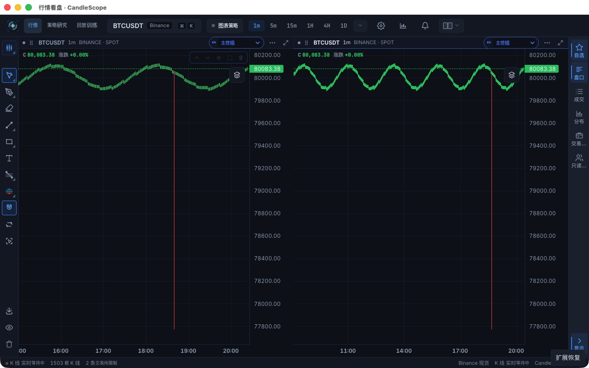
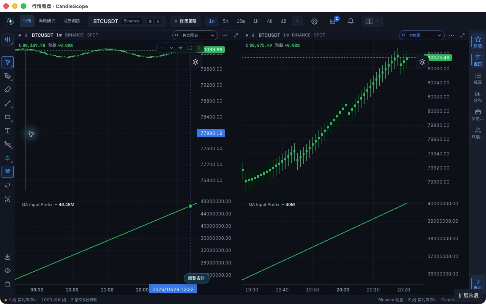

# Shared market manager acceptance — 2026-10-29

Latest integrated implementation and recovery follow-up: [2026-10-30 report](POST_INTEGRATION.md).

This historical report qualifies the implementation at `8e7d13fb` against baseline
`ce07e1bf`. It does not qualify subsequent mainline integration or a packaged
release. Earlier unchanged-path cases identify `0addb792` in their JSON receipts.
The original baseline and candidate assets have SHA-256 manifests in the local
archive. All user actions used the actual Chrome or isolated native UI.

## Observed behavior

- Independent same-symbol dual charts: A uses proven shared history, expands to
  the 10,000-row private window bound, and returns to live; B's rows and viewport
  remain unchanged. A shared historical correction reaches both retained ranges.
  Delayed 5m → 15m switching leaves the selected 15m data, with B still on 1m.
  [Machine-readable comparison](browser-navigation.json).
- Native minimization is confirmed through the desktop lifecycle, not inferred
  from document visibility. Disconnect, three new bars and an old correction are
  injected. Reconnect recovers new rows; a backfill-completion notice recovers the
  old correction. Hidden scheduling has zero runnable frames. On restore, both
  displays contain the correct 1,503 rows without another market tick.
  [Recovery stages](native-recovery.json).
- A frontend JS cumulative script with an artificial 150ms computation delay
  survives 100 updates at 20ms intervals plus a historical amendment while hidden.
  After restore, every output equals the supplied input prefix. A then expands to
  1,000 input rows while B retains 500; both results match their own origin. A
  correction before B's input changes A's result and preserves B's rows, viewport
  and result. The first immediate correction snapshot captured work still in
  flight; the subsequent settled snapshot is the numerical acceptance point.
  [Indicator and handoff evidence](native-indicator-and-warming.json).
- Keyboard focus on a period warms it without changing the chart. A 5-second
  delayed warm request is promoted on selection; server records show one
  500-row HTTP request and no duplicate scoped viewport request. The same event
  handlers cover pointer hover, but focus/promotion is the directly qualified
  gesture here; mouse dwell/cancellation behavior is covered by regression tests.
- Full watchlist subscription shares the chart connection: one physical stream,
  three logical consumers and 16 periods. Downgrading to price-only leaves the
  two chart consumers and their periods receiving updates. Quotes retain their
  separate protocol.
- An isolated cache pressure probe admits 2,020,000 rows across repeated new
  identities, never exceeds 200,000 retained rows, protects active input, revokes
  evicted versions and permits a fresh read without reviving an old version.
  After 100–400 batches, sampled forced-GC heap is 51.91–51.94 MiB. This is a
  short Node cache probe, not proof of whole-app retained memory or hours of use.
  [Cache samples](cache-stress.json).

## Fixed-input comparison

Same native QA host, 1,501 rows per chart, no indicators, left chart active,
200 forming updates on an absolute 50ms schedule, one warmup and five measured
runs per build/layout. Each retained consumer observed all 1,000 measured commits
and displays. All measured runs use one physical stream and zero HTTP reads.
Milliseconds below are pooled P95; arrows mean baseline → candidate.

| Layout / consumer | Input to Store commit | Input to chart-series publication |
| --- | ---: | ---: |
| single / focused | 0.3 → 0.3 | 14.9 → 16.1 |
| dual / focused | 0.3 → 0.3 | 9.7 → 16.9 |
| dual / visible-secondary | 0.3 → 0.6 | 15.5 → 17.4 |

The shared manager does **not** establish a general speedup. The secondary
consumer adds about 0.3ms at P95 admission; display P95 increases by 1.2ms for
single, 7.2ms for dual focused and 1.9ms for dual secondary in this run. Frame
scheduling phase affects publication latency, so these numbers are a measured
cost rather than a throughput claim. A prior relative-sleep fixture and a
mixed-focus baseline run are preserved but excluded from this table.

Heap samples overlap and include observation overhead; no application memory
reduction is claimed. Two-RAF timestamps are included in the
[full metric receipt](performance-summary.json), but they are not GPU presentation
or frame-rate measurements. The read-only observer scans snapshots once per
second and is identical across the paired builds. Live exchange latency,
indicator-heavy throughput and lower-powered hardware are not measured here.

## Checks and remaining boundaries

`npm run check`: 4,524 functional tests, one isolated performance gate, 123 desktop
tests, architecture/plugin/i18n, TypeScript, ESLint and production build all pass.
The native handoff bug was reproduced with a failing production `getBars` test
before its fix. Preemption regression verifies 1s-to-30s backoff and cancellation.

- No cross-tab/cross-process shared memory is claimed; the pool belongs to a
  mounted frontend workspace. Existing native seed transfer is not new shared
  cache ownership.
- Disconnect cannot discover an unannounced correction outside the reloaded
  range. Backfill/amendment notifications and fresh repair reads remain necessary.
- The numerical native indicator test is the explicit bounded-input frontend JS
  route. Hosted Pine prefix/version races are regression-tested, but an exhaustive
  live exchange/hosted-runtime race matrix is not claimed.
- Cache budgets are hard bounds; active retention is a preference inside those
  bounds. Speculative bytes are estimated, not a byte-accurate heap quota.
- Native QA uses a production renderer in an isolated Electron host. Final PR
  head arm64/x64 packaging and bundled-backend restart results must be read from
  the PR/issue; these screenshots do not establish package acceptance.

Raw logs, fixed corpus, fixture, observers, comparison scripts and asset manifests
are retained at `output/issue-123-market-manager-20261029` in the local checkout.
No credential/profile files or backend databases are part of these committed
receipts. Issue evidence checkpoint:
[comment 6498997169](https://github.com/helenananaa/CandleScope/issues/123#issuecomment-6498997169).
